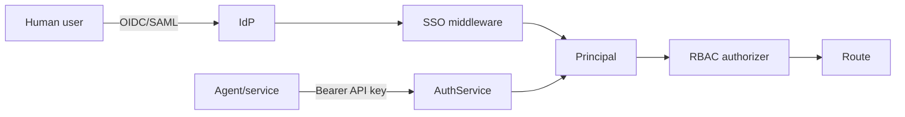
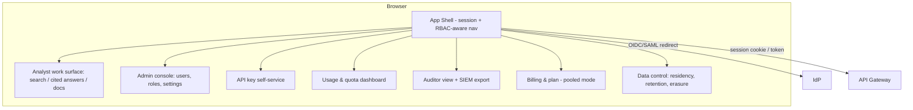

# Design Document — Enterprise Hardening (Bank-Grade)

## Overview

This design hardens the existing engine into a bank-grade product sellable in the US
and EU, supporting both pooled multi-tenant SaaS and dedicated single-tenant
deployments from one codebase. It positions the product as verifiable, auditable
evidence retrieval (not a decision/advisory system). The sections below cover the
guiding principle, deployment topologies (Architecture), the provider abstraction and
subsystem interfaces (Components and Interfaces), the persisted shapes (Data Models),
and cross-cutting concerns (encryption, identity, audit, observability, IaC, DR).

## Guiding Principle

**One codebase, one container image, configuration-selected behavior.** Every
environment difference (pooled SaaS vs. dedicated VPC vs. customer-managed) is
expressed through configuration and Infrastructure-as-Code — never a code fork. The
application depends only on **provider interfaces**; concrete implementations are
chosen at startup. This extends the dependency-injection discipline already present
in the codebase (`create_app(...)` accepts injected `auth_service` and `rate_limiter`;
`AuthService` accepts a `db_pool`).

## Architecture

### Deployment Topologies

```mermaid
flowchart TB
    subgraph Mode A — Pooled SaaS (operator AWS)
        LB1[ALB / TLS] --> API1[API tasks x N]
        API1 --> PG1[(RDS Postgres, shared)]
        API1 --> RD1[(ElastiCache Redis)]
        API1 --> OS1[(OpenSearch)]
        API1 --> S31[(S3, KMS)]
        API1 --> SM1[Secrets Manager]
    end

    subgraph Mode B1 — Dedicated VPC (operator AWS, 1 tenant)
        LB2[ALB / TLS] --> API2[API tasks x N]
        API2 --> PG2[(RDS, dedicated)]
        API2 --> S32[(S3, customer CMK)]
    end

    subgraph Mode B2 — Customer-managed (bank AWS account)
        LB3[ALB / TLS] --> API3[API tasks x N]
        API3 --> PG3[(RDS in bank account)]
        API3 --> S33[(S3 in bank account, bank CMK)]
        API3 --> SM3[Bank Secrets Manager]
    end
```

All three run the identical image. Differences:

| Concern | Pooled | Dedicated VPC | Customer-managed |
|---|---|---|---|
| Tenancy | many `tenant_id` | one | one |
| Data stores | shared | dedicated | in bank account |
| KMS keys | operator CMK | customer CMK | bank CMK |
| Secrets | operator Secrets Mgr | operator Secrets Mgr | bank Secrets Mgr |
| Telemetry sink | operator | operator or customer | customer only |
| Deploy control | operator | operator | operator-supplied IaC, bank-run |

## Components and Interfaces

### Provider Abstraction Layer

Introduce a `backend/providers/` package with interfaces + implementations, selected by
a `ProviderFactory` keyed on settings. Application/services receive providers via the
app factory; they never import a concrete provider. (Named `providers`, not `platform`,
to avoid shadowing Python's stdlib `platform` module when `backend/` is on `sys.path`.)

```python
# backend/providers/secrets.py
class SecretsProvider(Protocol):
    async def get_secret(self, name: str) -> str: ...
    async def get_secret_json(self, name: str) -> dict: ...

# Implementations:
#   EnvSecretsProvider          (dev / pooled bootstrap)
#   AwsSecretsManagerProvider   (pooled, dedicated_vpc, customer_managed)
#   AwsSsmParameterProvider     (optional alternative)
```

Same pattern for:

- `KmsProvider` — `encrypt(plaintext, key_id) / decrypt(ciphertext)`; impls:
  `LocalDevKms` (dev only), `AwsKmsProvider` (envelope encryption with data keys).
- `ObjectStore` — `put/get/delete`; impls: `MinioObjectStore` (dev),
  `S3ObjectStore` (prod, server-side encryption with CMK).
- `IdentityProvider` — human SSO; impls: `OidcIdentityProvider`,
  `SamlIdentityProvider`. API-key auth stays separate (existing `AuthService`).

### Provider selection

```python
# backend/providers/factory.py
def build_providers(settings: Settings) -> Providers:
    mode = settings.deployment_mode
    secrets = (AwsSecretsManagerProvider(...) if settings.secrets_backend == "aws"
               else EnvSecretsProvider())
    kms = AwsKmsProvider(settings.kms_key_id) if settings.kms_backend == "aws" else LocalDevKms()
    store = S3ObjectStore(...) if settings.object_store == "s3" else MinioObjectStore(...)
    idp = build_idp(settings)  # oidc | saml | none
    return Providers(secrets=secrets, kms=kms, object_store=store, idp=idp)
```

`create_app()` is extended to accept an optional `providers: Providers`; when omitted
it calls `build_providers(get_settings())`. This preserves existing test injection.

## Data Models

This section defines the new/changed persisted shapes introduced by hardening.

### Configuration & Mode Enforcement

Extend `Settings` (pydantic-settings) with a typed config surface:

```python
class DeploymentMode(str, Enum):
    POOLED = "pooled"
    DEDICATED_VPC = "dedicated_vpc"
    CUSTOMER_MANAGED = "customer_managed"

# new fields
deployment_mode: DeploymentMode = POOLED
dedicated_tenant_id: str | None = None
data_residency_region: str = "eu-west-1"
secrets_backend: Literal["env", "aws"] = "env"
kms_backend: Literal["local", "aws"] = "local"
kms_key_id: str | None = None
object_store: Literal["minio", "s3"] = "minio"
idp_kind: Literal["none", "oidc", "saml"] = "none"
telemetry_sink: str | None = None
```

**Fail-fast validation** at startup: a `validate_for_mode()` routine asserts the
required keys for the chosen mode (e.g., `dedicated_vpc` requires `dedicated_tenant_id`,
`kms_key_id`, `secrets_backend == "aws"`). Missing keys → process exits with a message
naming each one (Req 1.5).

**Single-tenant enforcement:** a middleware (running after auth resolves `tenant_id`)
checks, when mode ∈ {dedicated_vpc, customer_managed}, that
`request.state.tenant_id == settings.dedicated_tenant_id`, else returns the uniform
`resource_not_found` (reusing the existing cross-tenant 404 pattern).

### Persisted Shapes

```text
EncryptedContent (application envelope, Req 3.4)
  ciphertext        : bytes        # AES-GCM ciphertext of document content
  wrapped_data_key  : bytes        # data key wrapped by KMS CMK
  key_id            : str          # KMS key identifier used
  nonce             : bytes

AuditEntry (extended, Req 5)
  entry_id          : uuid
  tenant_id         : str
  actor             : str
  action            : str
  resource          : str
  request_id        : str
  detail            : json         # PII/secret-free
  emitted_at        : timestamptz
  prev_hash         : str          # hash of previous entry in tenant chain
  entry_hash        : str          # SHA256(canonical(entry) || prev_hash)

ApiKey (existing, unchanged) — key_prefix, key_hash (Argon2id), tenant_id,
  expires_at, revoked_at, rotation_grace_seconds

TenantConfig (new)
  tenant_id            : str
  deployment_mode      : enum
  data_residency_region: str
  retention_days       : int
  sso_required         : bool
  idp_kind             : enum(none|oidc|saml)
```

## Secrets Management

- All secret reads route through `SecretsProvider`. The `database_url`, LLM keys, S3
  keys, and the audit signing key are fetched at startup (and refreshed on a timer for
  rotation, Req 2.4).
- `Settings` stops carrying secret *values* in production; instead it carries secret
  *names/ARNs*. Dev keeps `.env` via `EnvSecretsProvider`.
- A logging filter (`SecretRedactionFilter`) scrubs known secret values and common
  patterns from all log records, including exception text (Req 2.6).
- `.env` remains gitignored (already verified). The Groq key currently in `.env` MUST
  be rotated before any customer engagement and migrated to Secrets Manager.

## Encryption

- **In transit:** TLS terminates at the ALB; the app additionally supports being run
  behind TLS and rejects non-TLS for API routes in prod (an `https_only` guard
  honoring `X-Forwarded-Proto`). Internal service-to-service across trust boundaries
  uses TLS.
- **At rest (infra):** RDS, S3, OpenSearch, ElastiCache all enabled with KMS
  encryption via IaC (CMK in dedicated/customer modes).
- **At rest (application envelope):** sensitive document content is encrypted with a
  per-tenant data key via `KmsProvider` before persistence. Stored as
  `{ciphertext, wrapped_data_key, key_id}`. Decryption on read. This means raw storage
  access alone does not reveal content (Req 3.4).

## Human Identity (SSO) and RBAC

Two distinct authentication planes, unified at authorization:



- **SSO middleware**: validates OIDC ID tokens / SAML assertions, verifies issuer +
  signature + expiry, extracts subject, tenant, and group/role claims. Establishes a
  short-lived session (signed cookie or bearer session token). No password store.
- **Principal**: unified `{tenant_id, subject, roles, auth_kind}` placed on
  `request.state` regardless of auth plane.
- **RBAC**: a permission matrix (role → allowed actions). A dependency/decorator on
  routes checks the principal's roles. Roles: `org_admin`, `analyst`, `auditor`,
  `read_only`. `auditor` = audit read-only (Req 4.4).
- Machine API keys map to a service role with configured scopes; SSO unaffected.

## Tamper-Evident Audit Log

Extend the existing `audit_log` subsystem:

- Each entry stores `prev_hash` and `entry_hash = SHA256(canonical(entry) || prev_hash)`,
  forming a per-tenant hash chain. The signing/seed key comes from `SecretsProvider`.
- `verify_chain(tenant_id, from, to)` recomputes the chain and returns the first broken
  link if any (Req 5.3).
- **Export**: `GET /v1/audit/export` (auditor/org_admin only) streams the tenant's
  entries as newline-delimited JSON suitable for SIEM ingest, scoped to the caller's
  tenant (Req 5.4).
- Entries already exclude tokens; redaction filter ensures no PII/secret leaks (Req 5.5).
- Separate retention timer for audit (≥ 365 days), independent of business-data
  retention (Req 5.6).

## PII Redaction (replace the stub)

Implement `PiiRedactor` with regex+validator detectors for email, phone, credit card
(Luhn), IBAN (checksum), and configurable national-id patterns. Wire it into:

- The logging filter (so request logs are redacted),
- Audit entry `detail` construction,
- Strict mode: query strings redacted before logging (Req 6.4).

It does **not** touch primary business documents (Req 6.3). Each detector has unit
tests proving redaction (Req 6.5).

## Data Residency, Retention, Erasure

- `data_residency_region` pins all stateful resources via IaC; no cross-region
  replication unless explicitly configured (Req 7.1).
- Per-tenant retention config drives a sweep job deleting expired business data within
  24h (extends existing session retention pattern).
- **Erasure API**: `POST /v1/tenant/erasure` (org_admin) deletes the tenant's business
  data (documents, sessions, index entries, object-store blobs), emits `tenant_erasure`
  audit event, preserves the PII-free audit log (Req 7.3).
- Customer-managed mode disables operator-bound telemetry egress (Req 7.5).

## Statelessness & Scale

- **Remove the in-memory document store from the serving path.** Today `IndexerService`
  keeps `_documents` in process and the app reloads from Postgres on boot. Make
  Postgres + OpenSearch the source of truth; the in-memory maps become a per-request
  cache only, or are removed. This is the single biggest scale-correctness fix.
- Bounded asyncpg pool (min/max), 429/503 load-shedding on pool exhaustion (Req 8.3).
- `/health/live` (process up) and `/health/ready` (deps reachable) probes; readiness
  fails if DB/OpenSearch/Redis unavailable (Req 8.4).
- Run ≥ 2 stateless API tasks behind the ALB; no sticky sessions (Req 8.5). SSE
  streams are per-connection and don't require stickiness for correctness.

## Observability

- Structured JSON logs (the project already uses `structlog`) with request_id +
  tenant_id, secrets/PII-filtered.
- Metrics via OpenTelemetry (already a dependency): request rate/error/latency
  histograms per endpoint, exported to CloudWatch/OTLP.
- Traces via OTel spanning gateway → retriever → answer engine, correlation id
  propagated.
- Telemetry sink is configurable; in customer-managed mode it points only to a
  customer destination (Req 9.5).

## Secure SDLC (CI/CD)

Extend `.github/workflows/ci.yml`:

- `pip-audit`/`safety` dependency scan (fail on new high/critical).
- SAST (`bandit` for Python) + secret scanning (`gitleaks`).
- Build image, scan with `trivy` before publish.
- Generate SBOM (`syft`) as a release artifact.
- Dependencies pinned (pyproject already pins; enforce in CI).

## Infrastructure as Code

`infra/terraform/` with composable modules:

- `modules/network` (VPC, subnets, SGs), `modules/data` (RDS, ElastiCache,
  OpenSearch, S3), `modules/kms`, `modules/secrets`, `modules/compute`
  (ECS Fargate service + ALB), `modules/observability`.
- Root stacks: `envs/pooled`, `envs/dedicated`, `envs/customer-managed`, each
  parameterizing region, KMS source, tenant id.
- Least-privilege IAM task roles; no wildcard admin (Req 11.4). Runbook + rollback
  documented.

**Compute choice:** ECS Fargate (simpler than EKS for a solo founder; banks accept it).
EKS can be offered later if a customer mandates Kubernetes.

## Availability / Backup / DR

- RDS automated backups + PITR; S3 versioning; documented RPO/RTO.
- Multi-AZ RDS/OpenSearch in pooled and dedicated modes.
- Restore procedure verifiable in a staging environment.

## Enterprise Frontend

The existing Next.js 14 app (Tailwind + Framer Motion + GSAP) provides the analyst
work surface (search, cited-answer with SSE + span citations, indexing). This is the
strongest existing piece and is reused. The hardening work wraps it in the enterprise
"envelope" that makes it feel like real SaaS to a bank buyer.

### Architecture



### Components

- **App shell**: post-SSO layout; reads the `Principal` (roles, tenant, mode, region)
  from a `/v1/me` endpoint; renders nav by RBAC. Shows Deployment_Mode +
  Data_Residency_Region in the header (Req 13.11).
- **Auth flow**: OIDC/SAML redirect; no password UI. Session via secure, httpOnly,
  SameSite cookie or short-lived bearer; silent refresh; idle timeout.
- **RBAC-aware rendering**: a `usePermissions()` hook gates routes and controls;
  server still enforces (UI gating is convenience, not security) (Req 13.2).
- **Admin console**: members table, invite/remove, role assignment, tenant settings
  (SSO config, residency, retention).
- **API key self-service**: create returns the full secret exactly once (copy-to-
  clipboard, then prefix-only thereafter); revoke with confirmation (Req 13.4).
- **Usage dashboard**: charts of query/document counts vs. quota (data from metering).
- **Auditor view**: filterable audit table (actor/action/time), export-to-NDJSON
  button hitting `/v1/audit/export`; PII/secret-free (Req 13.6).
- **Billing** (pooled only): plan card + redirect to billing-provider customer portal.
- **Data-control settings**: retention config + erasure request with double
  confirmation and audit feedback.

### Cross-cutting frontend concerns

- **Accessibility:** target WCAG 2.1 AA (full conformance requires manual assistive-tech
  testing and expert review — the build targets it; certification is out of scope here).
- **No third-party leakage:** no secrets/PII to analytics; analytics optional and
  disabled in customer-managed mode.
- **Theming:** the dark brand theme is retained; an enterprise light theme is optional.
- **Deployment:** built as static/SSR Next.js, served behind the same ALB/TLS; in
  customer-managed mode it ships in the same image set with no external calls except to
  the in-boundary API and the tenant's IdP.

## Build Order Rationale

Security-credibility and correctness blockers first (secrets, encryption, statelessness,
PII), then identity (SSO/RBAC), then audit integrity, then the operational/compliance
evidence (observability, CI security, IaC, DR). Each phase is independently demoable to
a security reviewer. The provider abstraction (Phase 0) is built first because
everything else depends on it and retrofitting it later would be expensive.

## Error Handling

- **Fail-fast on misconfiguration:** missing mode-required config or unresolved
  secrets cause the process to exit at startup with a message naming each missing key
  (Req 1.5, 2.5) — never silent degradation into an insecure state.
- **Uniform not-found for isolation:** cross-tenant access and (in single-tenant modes)
  wrong-tenant access return the same `resource_not_found` shape, leaking no existence
  information (reuses existing pattern).
- **Auth/SSO failures:** invalid/expired/untrusted assertions return a generic auth
  error and emit an `auth_failure` audit event with no secret material.
- **Overload:** connection-pool exhaustion sheds load with 429/503 rather than crashing
  (Req 8.3).
- **Provider failures:** a transient secrets/KMS/object-store error surfaces as a 503
  on readiness and a retryable error on the request; it never logs secret values.
- **Audit integrity failure:** `verify_chain` returns the first broken link rather than
  a boolean, so investigators can locate tampering.

## Testing Strategy

- **Unit:** each provider implementation (env/AWS secrets, local/AWS KMS round-trip,
  object store), each PII detector class, RBAC allow/deny matrix, mode validation.
- **Integration:** single-tenant enforcement rejects foreign tenant; SSO token
  validation (valid/expired/wrong-issuer); audit hash-chain tamper detection; erasure
  completeness with audit preserved; readiness reflects dependency outage.
- **Property-based:** envelope encrypt/decrypt round-trip for arbitrary content;
  audit chain remains verifiable across arbitrary append sequences.
- **Security/CI gates:** dependency, SAST, secret, and image scans run on every change
  (Phase 10) and act as continuous regression tests for the supply chain.
- **IaC:** `terraform plan` validates for each of the three env stacks.
- **DR:** restore procedure verified in a staging environment (Req 12.4).

## Correctness Properties

### Property 1: No-fork invariant
The same container image runs all three deployment modes; only configuration and IaC
differ. No mode-specific code branches exist outside provider selection.

**Validates: Requirements 1.3, 1.4**

### Property 2: Secret confinement
No secret value appears in source code, the container image, logs (incl. tracebacks),
or version control. All secrets are read via `SecretsProvider`.

**Validates: Requirements 2.1, 2.2, 2.6**

### Property 3: Tenant isolation
No request ever reads another tenant's data. Cross-tenant access — and, in
single-tenant modes, any wrong-tenant request — returns the uniform `resource_not_found`
shape, leaking no existence information.

**Validates: Requirements 1.2**

### Property 4: Audit immutability
Any insertion, modification, or deletion of an audit entry breaks the per-tenant hash
chain and is detected by `verify_chain`, which reports the first broken link.

**Validates: Requirements 5.2, 5.3**

### Property 5: Data residency
A tenant's data never leaves its configured region absent explicit configuration; in
customer-managed mode, no business data or telemetry egresses to the operator.

**Validates: Requirements 7.1, 7.5**

### Property 6: Statelessness
Request correctness is independent of which API instance serves it; all shared state
lives in external stores.

**Validates: Requirements 8.1, 8.5**

## Non-Goals

- Not building a decision/advisory engine (regulatory line: evidence only).
- Not pursuing formal SOC 2 / ISO 27001 certification within this spec — but producing
  the technical controls and evidence that make those audits achievable.
- Not implementing EKS/Kubernetes unless a deal requires it (Fargate first).

## Compliance, Legal & Organizational Readiness (Non-Code)

A strong codebase is necessary but not sufficient for Tier-1 financial onboarding. The
following are tracked as explicit out-of-band prerequisites (Requirement 14). They
require third parties and time/money; code alone does not satisfy them.

| Item | Nature | Notes |
|---|---|---|
| Third-party penetration test | Vendor engagement | Annual; remediate + retain report |
| SOC 2 Type II / ISO 27001 | Auditor process (6–12 mo) | Map Req 1–13 controls as evidence |
| DPA (GDPR Art. 28), MSA, SLA | Legal | SLA with penalties; breach-notification timelines |
| Cyber-liability insurance | Insurance | Often a contractual requirement |
| Incident response, change mgmt, access reviews, BCP | Process docs | Named security owner |
| Incorporated legal entity | Corporate | Banks contract with entities, not individuals |
| Threat model + data-flow diagrams | Deliverables | Kept current with architecture |

**Control-to-evidence mapping:** the technical requirements double as audit evidence —
e.g., Req 2/3 → cryptography controls, Req 4/6 → access control, Req 5 → audit logging,
Req 7 → data lifecycle, Req 10/11 → secure SDLC and change management. This mapping is
what an auditor consumes; building it now shortens the eventual certification.

**Web-layer protections** (Req 14.7) land technically in P2 (security headers, CSRF)
and P11 (AWS WAF/Shield in front of the ALB).
