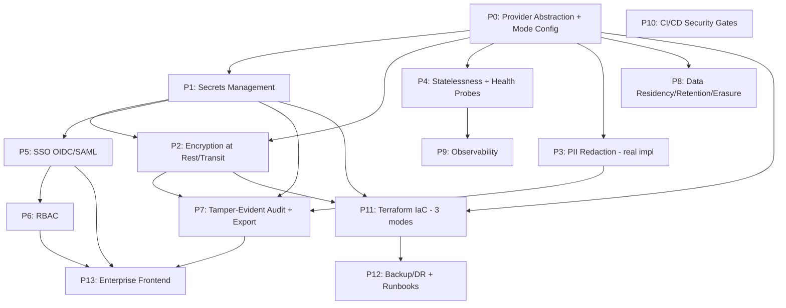

# Implementation Plan: Enterprise Hardening

## Overview

This plan hardens the engine to a bank-grade bar while supporting pooled SaaS,
dedicated-VPC, and customer-managed (in-bank-account) deployments from one codebase on
AWS. Work is organized into phases P0–P12 and four demoable milestones (M1–M4). The
provider abstraction (P0) is built first because all later phases depend on it.

## Task Dependency Graph

```json
{
  "waves": [
    { "wave": 1, "tasks": ["P0"] },
    { "wave": 2, "tasks": ["P1", "P3"] },
    { "wave": 3, "tasks": ["P2", "P4"] },
    { "wave": 4, "tasks": ["P5", "P7", "P8", "P9"] },
    { "wave": 5, "tasks": ["P6"] },
    { "wave": 6, "tasks": ["P10", "P11", "P13"] },
    { "wave": 7, "tasks": ["P12"] }
  ]
}
```



## Tasks

### Phase 0 — Provider Abstraction & Deployment Modes (foundation)

- [ ] 0.1 Add `DeploymentMode` enum and new config fields to `backend/config/settings.py`
      (deployment_mode, dedicated_tenant_id, data_residency_region, secrets_backend,
      kms_backend, kms_key_id, object_store, idp_kind, telemetry_sink).
- [ ] 0.2 Implement `validate_for_mode()` fail-fast startup validation (Req 1.5).
- [ ] 0.3 Create `backend/providers/` package with Protocols: `SecretsProvider`,
      `KmsProvider`, `ObjectStore`, `IdentityProvider`, plus `Providers` dataclass.
- [ ] 0.4 Implement dev/no-op providers: `EnvSecretsProvider`, `LocalDevKms`,
      `MinioObjectStore`, `none` IdP.
- [ ] 0.5 Add `build_providers(settings)` factory and extend `create_app()` to accept
      optional `providers` (preserve existing test injection).
- [ ] 0.6 Add single-tenant enforcement middleware for dedicated/customer-managed modes
      (reuse cross-tenant `resource_not_found` pattern) (Req 1.2).
- [ ] 0.7 Tests: mode validation, provider selection, single-tenant rejection.

### Phase 1 — Secrets Management

- [ ] 1.1 Implement `AwsSecretsManagerProvider` (boto3) with in-memory TTL cache and
      timed refresh for rotation (Req 2.4).
- [ ] 1.2 Route DB creds, LLM keys, S3 keys, audit signing key through `SecretsProvider`;
      `Settings` holds secret *names/ARNs* in prod, values only in dev.
- [ ] 1.3 Add `SecretRedactionFilter` to the logging config; scrub secret values and
      patterns from all log records incl. tracebacks (Req 2.6).
- [ ] 1.4 Fail-fast if a required secret is unresolved at startup (Req 2.5).
- [ ] 1.5 Rotate the Groq key currently in `.env`; document migration to Secrets Manager.
- [ ] 1.6 Tests: provider cache/refresh, redaction filter, startup failure path.

### Phase 2 — Encryption

- [ ] 2.1 Implement `AwsKmsProvider` with envelope encryption (GenerateDataKey) and a
      `LocalDevKms` for tests.
- [ ] 2.2 Add application-layer envelope encryption for sensitive document content at
      persistence boundary; store `{ciphertext, wrapped_data_key, key_id}` (Req 3.4).
- [ ] 2.3 Add `https_only` guard for API routes in prod honoring `X-Forwarded-Proto`.
- [ ] 2.4 Add security headers (CSP, HSTS, X-Frame-Options, X-Content-Type-Options) and
      CSRF protection for session-based flows (Req 14.7).
- [ ] 2.5 IaC flags for KMS-encrypted RDS/S3/OpenSearch/ElastiCache (lands in P11).
- [ ] 2.6 Tests: round-trip encrypt/decrypt, CMK key-id wiring, https guard, headers.

### Phase 3 — PII Redaction (replace stub)

- [ ] 3.1 Implement detectors: email, phone, credit card (Luhn), IBAN (checksum),
      configurable national-id patterns.
- [ ] 3.2 Replace `PiiRedactMiddleware` stub with real redaction for logs/audit detail.
- [ ] 3.3 Wire redactor into logging filter and audit `detail` construction.
- [ ] 3.4 Add strict mode (redact query strings before logging) (Req 6.4).
- [ ] 3.5 Tests per PII class (Req 6.5).

### Phase 4 — Statelessness & Health

- [ ] 4.1 Make Postgres + OpenSearch the source of truth in the serving path; demote the
      in-memory document store to per-request cache or remove (Req 8.2).
- [ ] 4.2 Bounded asyncpg pool config; 429/503 load-shedding on exhaustion (Req 8.3).
- [ ] 4.3 Add `/health/live` and `/health/ready` (deps checked) probes (Req 8.4).
- [ ] 4.4 Verify ≥2 instances behind a load balancer with no sticky sessions (Req 8.5).
- [ ] 4.5 Tests: readiness reflects dependency outage; load-shed under pool exhaustion.

### Phase 5 — SSO (OIDC/SAML)

- [ ] 5.1 Implement `OidcIdentityProvider` (token validation: issuer, signature, exp,
      audience; JWKS fetch/cache).
- [ ] 5.2 Implement `SamlIdentityProvider` for enterprise tenants.
- [ ] 5.3 SSO middleware → unified `Principal{tenant_id, subject, roles, auth_kind}` on
      request.state; short-lived signed session.
- [ ] 5.4 Per-tenant "SSO only / no password fallback" enforcement (Req 4.5).
- [ ] 5.5 `auth_failure` audit on invalid/expired/untrusted assertion, no secret logging.
- [ ] 5.6 Tests: valid/invalid/expired/wrong-issuer; machine API-key path unaffected.

### Phase 6 — RBAC

- [ ] 6.1 Define role → permission matrix (org_admin, analyst, auditor, read_only).
- [ ] 6.2 RBAC authorizer dependency/decorator on routes.
- [ ] 6.3 Map IdP group claims and machine keys to roles.
- [ ] 6.4 `auditor` = audit read-only; deny mutations (Req 4.4).
- [ ] 6.5 Tests: each role's allow/deny matrix; cross-role denial.

### Phase 7 — Tamper-Evident Audit + Export

- [ ] 7.1 Add `prev_hash`/`entry_hash` hash-chaining to audit entries (seed key from
      SecretsProvider).
- [ ] 7.2 Implement `verify_chain(tenant, from, to)` returning first broken link.
- [ ] 7.3 `GET /v1/audit/export` (auditor/org_admin), tenant-scoped NDJSON for SIEM.
- [ ] 7.4 Independent audit retention timer (≥365d).
- [ ] 7.5 Tests: chain integrity, tamper detection, export scoping, no PII/secret leak.

### Phase 8 — Data Residency / Retention / Erasure

- [ ] 8.1 Per-tenant retention config + sweep job (delete expired business data ≤24h).
- [ ] 8.2 `POST /v1/tenant/erasure` (org_admin): delete docs/sessions/index/blobs, emit
      `tenant_erasure`, preserve audit log (Req 7.3).
- [ ] 8.3 Region pinning honored across stores; document data-map per mode.
- [ ] 8.4 Disable operator telemetry egress in customer-managed mode (Req 7.5).
- [ ] 8.5 Tests: retention sweep, erasure completeness, audit preserved.

### Phase 9 — Observability

- [ ] 9.1 Structured JSON logs with request_id+tenant_id, secrets/PII-filtered.
- [ ] 9.2 OTel metrics: rate/error/latency p50/p95/p99 per endpoint.
- [ ] 9.3 OTel traces across gateway→retriever→answer with correlation id.
- [ ] 9.4 Configurable telemetry sink (customer destination in dedicated/customer modes).
- [ ] 9.5 Document SLOs.

### Phase 10 — CI/CD Security Gates

- [ ] 10.1 Dependency scan (`pip-audit`), fail on new high/critical.
- [ ] 10.2 SAST (`bandit`) + secret scan (`gitleaks`).
- [ ] 10.3 Image build + `trivy` scan before publish.
- [ ] 10.4 SBOM (`syft`) release artifact.
- [ ] 10.5 Enforce pinned dependencies.

### Phase 11 — Terraform IaC (3 modes)

- [ ] 11.1 Modules: network, data (RDS/ElastiCache/OpenSearch/S3), kms, secrets,
      compute (ECS Fargate + ALB), observability.
- [ ] 11.2 Root stacks: envs/pooled, envs/dedicated, envs/customer-managed (param region,
      KMS source, tenant id).
- [ ] 11.3 Least-privilege IAM task roles; no wildcard admin.
- [ ] 11.4 Reproducible-from-clean-account runbook + rollback procedure.
- [ ] 11.5 AWS WAF + Shield in front of the ALB (Req 14.7).
- [ ] 11.6 Validate `terraform plan` for each env.

### Phase 12 — Backup / DR

- [ ] 12.1 Automated encrypted RDS backups + PITR; S3 versioning.
- [ ] 12.2 Document RPO/RTO + restore procedure.
- [ ] 12.3 Multi-AZ stateful services (pooled, dedicated).
- [ ] 12.4 Verify restore in staging.

### Phase 13 — Enterprise Frontend (Admin Console & Work Surface)

- [ ] 13.1 SSO login flow (OIDC/SAML redirect, no password UI), secure session
      (httpOnly cookie / short-lived token), silent refresh, idle timeout.
- [ ] 13.2 `/v1/me` endpoint + app shell that reads Principal (roles, tenant, mode,
      region); header shows Deployment_Mode + Data_Residency_Region (Req 13.1, 13.11).
- [ ] 13.3 `usePermissions()` RBAC-aware nav/route/control gating (server still
      enforces) (Req 13.2).
- [ ] 13.4 Organization admin console: members table, invite/remove, role assignment,
      tenant settings (SSO, residency, retention) (Req 13.3).
- [ ] 13.5 API key self-service: create (full secret shown once + copy), list
      (prefix only), revoke with confirmation (Req 13.4).
- [ ] 13.6 Usage dashboard: query/document counts vs. quota from metering (Req 13.5).
- [ ] 13.7 Auditor view: filterable audit table (actor/action/time) + export-to-NDJSON
      to `/v1/audit/export`; no secrets/PII (Req 13.6).
- [ ] 13.8 Analyst work surface: reuse existing search + cited-answer (SSE, span
      citations) + document workspace (upload/index/list/delete), framed for compliance
      users (Req 13.7).
- [ ] 13.9 Billing & plan management (pooled mode): plan card + billing-provider
      customer-portal redirect (Req 13.8).
- [ ] 13.10 Data-control settings: retention config + erasure request with double
      confirmation and audit feedback (Req 13.9).
- [ ] 13.11 Accessibility pass (WCAG 2.1 AA target), responsive layout, no secrets/PII
      to third-party analytics; analytics disabled in customer-managed mode (Req 13.10).
- [ ] 13.12 Frontend served behind ALB/TLS; in customer-managed mode no external calls
      except in-boundary API + tenant IdP.

## Notes

### Suggested Milestones (demoable to a security reviewer)

- **M1 (credibility unlock):** P0 + P1 + P2 + P3 — no plaintext secrets, encryption,
  real PII redaction, mode-aware config.
- **M2 (enterprise identity):** P4 + P5 + P6 — stateless scale, SSO, RBAC.
- **M3 (audit & compliance):** P7 + P8 + P9 — tamper-evident audit, residency/erasure,
  observability.
- **M4 (vendor-risk evidence):** P10 + P11 + P12 — secure SDLC, IaC for all 3 modes, DR.
- **M5 (presentable product):** P13 — enterprise frontend (SSO, admin, API keys, usage,
  auditor view, work surface, data control). Depends on P5/P6 (SSO/RBAC) and P7 (audit
  export). This is the milestone you demo to a buyer.

### Out-of-Band Readiness (Non-Code, Requirement 14)

These are NOT engineering tasks — they require third parties, time, and money — but
they gate true Tier-1 onboarding and are tracked here for honesty:

- [ ] R14.1 Third-party penetration test + remediation; retain report.
- [ ] R14.2 SOC 2 Type II and/or ISO 27001; map Req 1–13 controls as evidence.
- [ ] R14.3 Legal layer: DPA (GDPR Art. 28), MSA, SLA, cyber-liability insurance.
- [ ] R14.4 Operational policies: incident response, change mgmt, access reviews, BCP;
      named security owner.
- [ ] R14.5 Incorporate a legal entity capable of contracting with a bank.
- [ ] R14.6 Formal threat model + data-flow diagrams; keep current.

### Honest Readiness Scorecard

- **Technical architecture & task plan:** ~9/10 — comprehensive and presentable to a
  bank's engineering reviewers once M1–M5 are built.
- **True Tier-1 vendor readiness:** gated by R14 (above). Code alone does not clear it;
  ~50% of the remaining gap is certification, legal, insurance, and entity formation.
- **Honest pitch:** "Bank-grade architecture with a sequenced implementation plan; the
  platform controls map to SOC 2 / ISO 27001, with a clear path to certification and
  the legal/insurance layer." Avoid claiming "JPMorgan-ready today."
